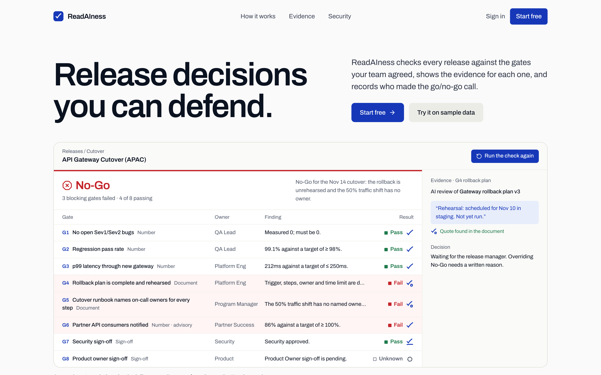
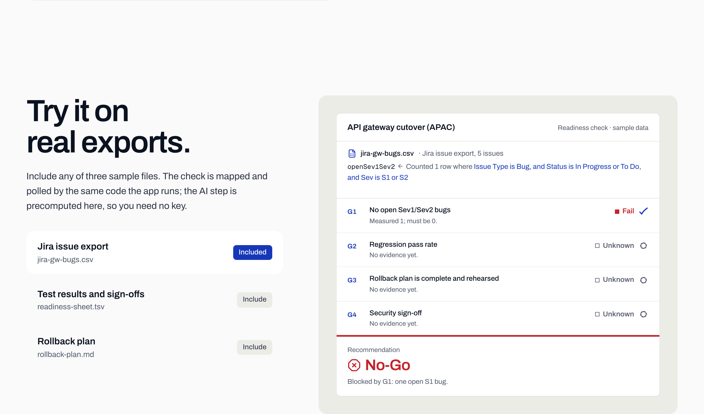
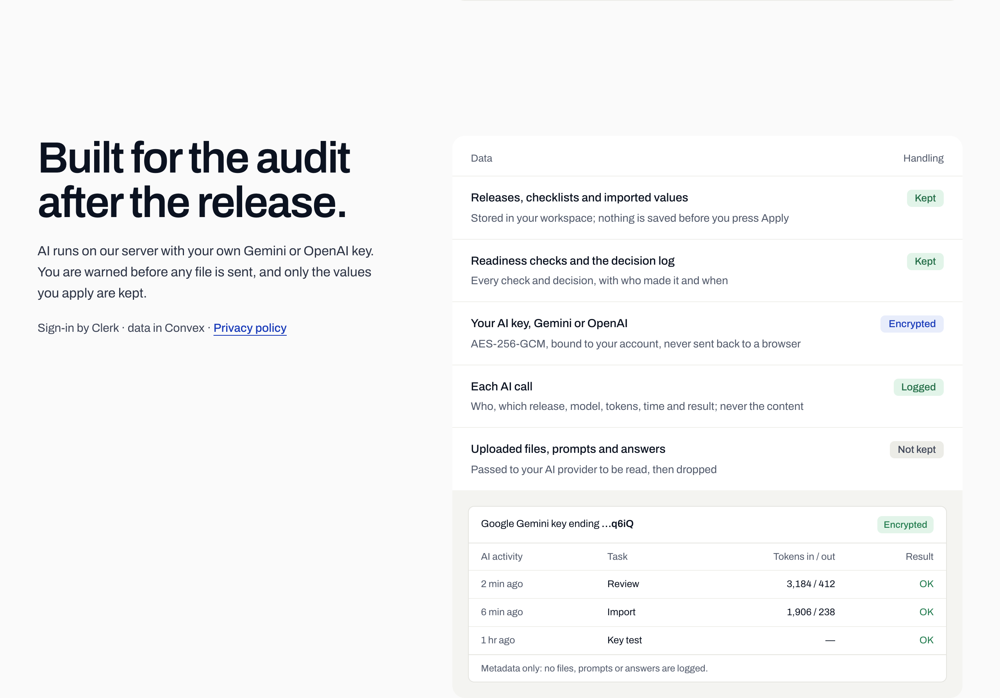
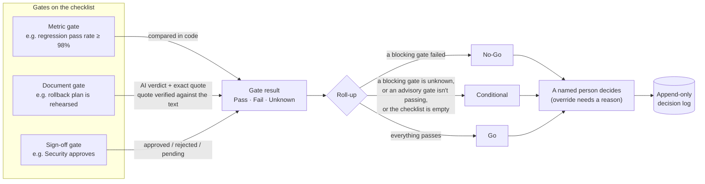
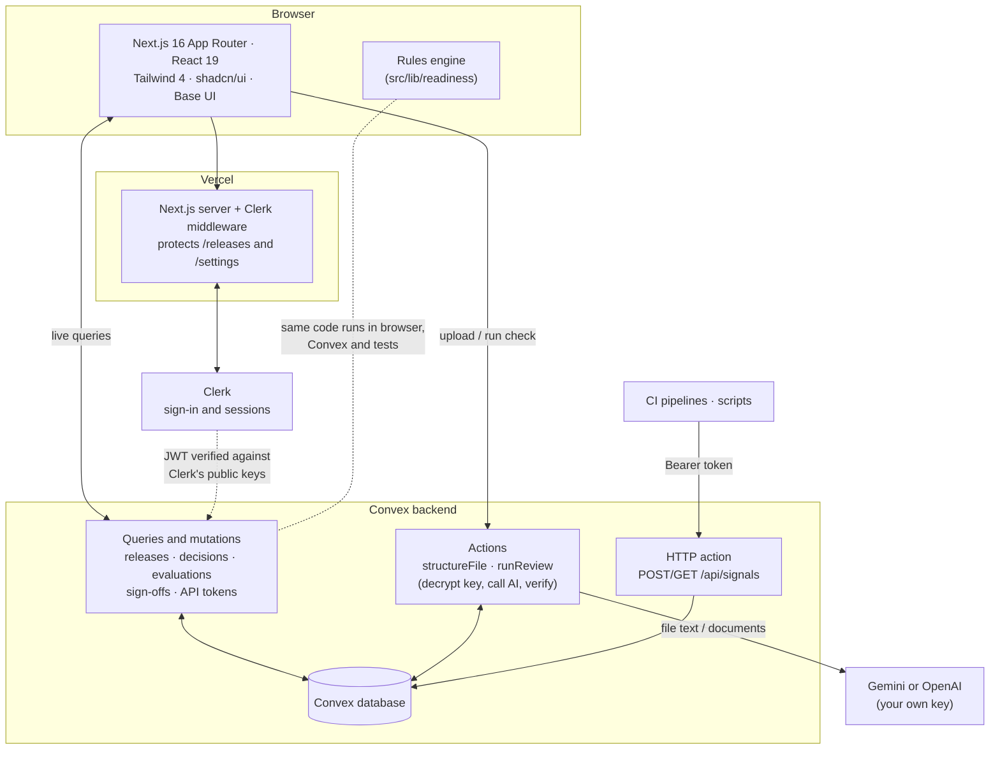
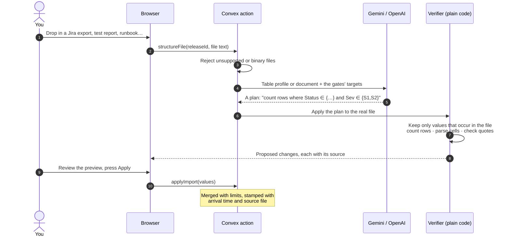
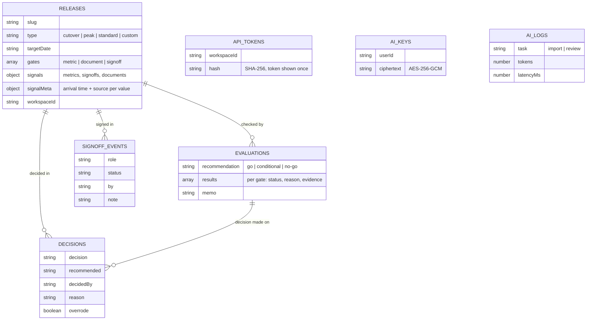

<div align="center">

<h1>Read<span>AI</span>ness</h1>

**Release decisions you can defend.**

Evidence-backed go/no-go calls for releases, migration cutovers and peak events.<br />
Numbers are checked in code. The AI must quote its sources. A person makes the call.

[**Live demo**](https://readainess.vercel.app) · [How it decides](#how-it-decides) · [Architecture](#architecture) · [Getting started](#getting-started) · [Push API](#push-api-for-ci-and-scripts)


<br />



</div>

---

## Why this exists

Most release meetings run on summaries: someone says "QA looks good", someone
else says "security is nearly done", and the call is made on confidence.
Most AI status tools make that worse by summarising more fluently.

ReadAIness does the opposite. It holds a release against the **gates your team
agreed in advance**, shows the **evidence behind every result**, and records
**who made the go/no-go call and why**. It cannot say a release is ready
without proof, and it never decides for you.

> **Four rules decide what counts**
>
> 1. **Numbers are checked in code.** Bug counts, pass rates and latency are
>    compared with the target by the rules engine. No model decides whether one
>    bug is more than zero.
> 2. **No quote, no pass.** The AI judges documents (is the rollback plan
>    complete?), but must quote the document word for word. The quote is checked
>    against the text, and an invented one is thrown out.
> 3. **Unknown is never green.** A gate with no evidence stays Unknown and never
>    counts as a pass.
> 4. **Every override has a reason.** The tool recommends and a named person
>    decides. Going against the recommendation needs a written reason, and the
>    log is never edited.

## What you can do

| | |
|---|---|
| **Agree the gates** | Start from a cutover, peak-event or standard checklist, copy the gates of another release, or write your own. Each gate is a number check, a document check or a sign-off, and is blocking or advisory. |
| **Bring the evidence** | Upload CSV, TSV, TXT or Markdown exports in whatever layout your tools produce, paste text, push values from CI, or sign off in the app. |
| **See why** | Every result shows its evidence: the value and where it was read, the quoted sentence, or who approved. Values show when they arrived and from which file. |
| **Make the call** | Record Go, Conditional or No-Go as a named person. Overrides need a reason. Decisions are append-only and superseded, never deleted. |
| **Track a portfolio** | A releases list with the tool's recommendation next to the person's decision, blockers, gates passing and a runway to each target date. |

<table>
  <tr>
    <td width="50%"></td>
    <td width="50%"></td>
  </tr>
  <tr>
    <td align="center"><sub><b>Import:</b> the AI says <i>where</i> a value is; code counts it and shows the rule it applied.</sub></td>
    <td align="center"><sub><b>Trust:</b> keys encrypted, AI calls logged as metadata only, uploaded files not kept.</sub></td>
  </tr>
</table>

## How it decides

Every gate resolves to **Pass**, **Fail** or **Unknown**. The roll-up is plain code in
[`src/lib/readiness`](src/lib/readiness), shared by the browser, the backend and the tests.



| Gate kind | Decided by | Passes when |
|---|---|---|
| **Metric** | The rules engine | The imported number meets `≤`, `≥` or `==` the target |
| **Document** | AI judgement, verified in code | The AI passes it **and** its quote appears in the document |
| **Sign-off** | A person | The named role has approved |

A **blocking** gate that fails makes the call No-Go. An **advisory** gate can only make it Conditional.

## Architecture



**Design choices worth knowing**

- **One rules engine, three places.** [`src/lib/readiness`](src/lib/readiness) has no React, Next.js or Convex imports, so the exact code that decides Go/No-Go runs in the browser, in Convex functions and in the unit tests.
- **The workspace is never taken from the client.** Convex derives it from the verified Clerk session on every request, so one workspace cannot read another's releases, checks or decisions.
- **The AI never supplies a number.** On import it only proposes *where* a value lives (which columns to count, which cell, which sentence). Code reads the value from the file and rejects anything it cannot verify.
- **Bring your own key, kept on the server.** Keys are stored AES-256-GCM encrypted (bound to the user id) and only decrypted inside Convex actions. The browser never holds one. Every AI call is logged as metadata, never content.
- **Real-time by default.** The UI reads Convex live queries, so a sign-off, a pushed value or a teammate's decision shows up without a refresh.

### How an import is verified



### Data model



## Getting evidence in

| Way | Best for | Notes |
|---|---|---|
| **Upload or paste** | Exports from any tool | `.csv`, `.tsv`, `.txt`, `.md` up to 2 MB. Semicolon and tab delimiters are detected. Spreadsheets and PDFs must be exported as CSV or text first. Binary files are refused. |
| **Sign off in the app** | Approvals | Open a sign-off gate and Approve or Reject. Rejecting needs a note. Every change is logged with who and when. |
| **Push API** | CI and scripts | One `curl` from a pipeline. See below. |

The import is built to survive messy input. Unreadable AI answers, invented
quotes, a `1,5` that might mean 1.5 or 15, and a latency of `1.2 s` against a
millisecond target are all handled in code and covered by tests
([`negative.test.ts`](src/lib/import/negative.test.ts)). Ready-made example files, with
the values you should see, are in [`sample-uploads/`](sample-uploads/README.md).

## Push API for CI and scripts

Create a token in **Settings → API tokens** (shown once; only a SHA-256 hash is stored), then:

```bash
curl -X POST "https://<your-deployment>.convex.site/api/signals?release=<release-slug>" \
  -H "Authorization: Bearer $READAINESS_TOKEN" \
  -H "Content-Type: application/json" \
  -d '{
        "metrics":  { "regressionPassRate": 98.4 },
        "signoffs": { "Security": { "status": "approved", "by": "Priya Nair" } },
        "source":   "GitHub Actions run 123"
      }'
```

- `GET` the same URL to list the metric, sign-off and document names that release accepts.
- Only names a gate on that release reads are accepted, so a typo returns `422` instead of creating orphan data.
- Responses: `200` applied · `400` bad JSON or wrong type · `401` missing or revoked token · `404` release not in your workspace · `413` body over 200 KB · `422` unknown names.
- Pushed values carry the source label and time, shown on the release's **Data on file** panel.

## Tech stack

| Layer | Choice |
|---|---|
| Front end | Next.js 16 (App Router), React 19, TypeScript, Tailwind CSS 4, shadcn/ui on Base UI, Motion and GSAP |
| Backend | [Convex](https://convex.dev): database, live queries, server actions, HTTP actions |
| Auth | [Clerk](https://clerk.com), verified directly against Clerk's public keys (no JWT template) |
| AI | Google Gemini (default, free tier) or OpenAI, with the user's own key |
| Tests | Vitest: 64 tests across the rules engine, import verification, push parsing and the brief |
| Hosting | Vercel (app) and Convex (backend) |

## Getting started

**Prerequisites:** Node 20+, a free [Convex](https://convex.dev) account and a [Clerk](https://clerk.com) application.

```bash
git clone https://github.com/saxena28mayuri/readainess.git
cd readainess
npm install

npm run convex:login   # one-time browser approval
npm run convex         # creates a dev deployment and writes .env.local
npm run convex:seed    # loads the three synthetic sample releases
npm run dev            # http://localhost:3000
```

Then, once per deployment:

```bash
# Key-encryption secret for stored AI keys
HOME="$PWD/.convex-home" npx convex env set AI_KEY_SECRET "$(openssl rand -base64 32)"

# Clerk's issuer URL, so Convex can verify sign-in tokens
HOME="$PWD/.convex-home" npx convex env set CLERK_FRONTEND_API_URL https://<your-app>.clerk.accounts.dev
```

Clerk's keys go in `.env.local` (`npx clerk init` writes development keys). Open the app, sign in, and add a free
Gemini key (or an OpenAI key) in **Settings** to turn on AI import and review. Without a key the sample releases
still run on precomputed results.

<details>
<summary><b>Environment variables</b></summary>

| Variable | Where | Purpose |
|---|---|---|
| `NEXT_PUBLIC_CONVEX_URL` | `.env.local` / Vercel | Convex deployment URL |
| `NEXT_PUBLIC_CONVEX_SITE_URL` | `.env.local` / Vercel | Convex HTTP actions URL (the push API) |
| `NEXT_PUBLIC_CLERK_PUBLISHABLE_KEY`, `CLERK_SECRET_KEY` | `.env.local` / Vercel | Clerk keys |
| `NEXT_PUBLIC_CLERK_SIGN_IN_URL`, `…SIGN_UP_URL`, `…FALLBACK_REDIRECT_URL` | `.env.local` / Vercel | Clerk routes (see `.env.example`) |
| `CLERK_FRONTEND_API_URL` | Convex env | Clerk issuer for verifying tokens |
| `AI_KEY_SECRET` | Convex env | Encrypts stored AI keys (AES-256-GCM) |

</details>

The Convex scripts point `HOME` at a git-ignored `.convex-home` folder, so this project keeps its own
Convex login and never touches the one in `~/.convex`. Use that only on a machine you trust: the login token lives there.

### Scripts

```bash
npm run dev          # Next.js dev server
npm run build        # production build
npm test             # Vitest
npm run typecheck    # app and Convex
npm run lint
```

### Deploying

1. `npx convex deploy` to the production deployment, then set `AI_KEY_SECRET` and `CLERK_FRONTEND_API_URL` on it and run `releases:seedSamples`.
2. Create a Vercel project, set the variables above (pointing `NEXT_PUBLIC_CONVEX_URL` and `NEXT_PUBLIC_CONVEX_SITE_URL` at the **production** Convex deployment), and deploy.
3. For a public launch, switch Clerk to a production instance on your own domain.

## Project structure

```
convex/                   Backend: schema, queries, mutations, AI actions, HTTP push API
  schema.ts               Tables and validators (mirrors src/lib/readiness/types.ts)
  releases.ts             Create, copy, import, sign-off, edit gates, remove signal
  ai.ts                   Key storage and the structureFile / runReview actions
  http.ts · apiTokens.ts  Token-authenticated push API
src/
  app/(app)/              Signed-in product: releases, release, gates, import, settings
  app/(marketing)/        Home, privacy, terms
  components/release/     Gate table, decision panel, memo, sign-off, data on file
  lib/readiness/          Rules engine, templates, samples, merge (no framework imports)
  lib/import/             CSV parsing and verification of AI import plans
  lib/ai/                 Provider calls and prompts
sample-uploads/           Synthetic exports for trying the import
docs/screenshots/         Images used in this README
```

## Privacy and data

- **Kept:** releases, checklists, imported values, readiness checks and the decision log, scoped to your workspace.
- **Encrypted:** your AI key (AES-256-GCM, bound to your account, never sent back to a browser).
- **Logged:** each AI call as metadata only (who, release, model, tokens, time, result).
- **Not kept:** uploaded files, prompts and AI answers. They pass to your AI provider to be read, then are dropped.
- On Gemini's free tier, Google may use submitted content to improve its products. The app and its [privacy policy](https://readainess.vercel.app/privacy) say so plainly, and ask for consent before a first import.

All sample releases, people and figures are synthetic.

## Roadmap

Ideas, not promises:

- **Pull connectors** (Jira, Azure DevOps, GitHub, Datadog) so gates read live data instead of uploads, with a maximum age per gate so stale evidence counts as Unknown.
- **Risk-accepted waivers** for a failing gate, with an owner and an expiry.
- **Value history and trends** for each signal.
- **Saved templates** per workspace, and team roles for who may sign which gate.

## Author

Built by [Mayuri Saxena](https://github.com/saxena28mayuri) · [LinkedIn](https://www.linkedin.com/in/saxena-mayuri/)
